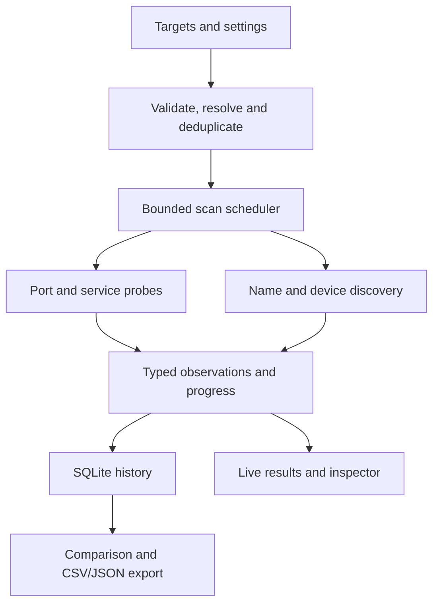

# Architecture

[Back to README](../README.md)

PortSpecter is a six-crate Rust workspace. The desktop runs an Iced interface and communicates with a backend worker; the core schedules bounded scan tasks and emits observations that the UI and storage consume.

| Crate | Responsibility |
| --- | --- |
| `portspecter-domain` | Target/port plans, settings, observations, device classification, vendor matching and exports |
| `portspecter-core` | Planning, scan orchestration, budgets, discovery coordination, cancellation and events |
| `portspecter-probe` | TCP/service inspection, UDP queries, name protocols and device discovery parsers |
| `portspecter-platform` | OS interfaces/routes/neighbors, ICMP, SMB helpers and native SYN capture/injection |
| `portspecter-storage` | SQLite migrations, sessions, observations, profiles and queue persistence |
| `portspecter-desktop` | Iced screens, application state, backend commands, localization and window integration |

## Scan lifecycle

Starting a scan is explicit. The plan preserves subnet memberships while deduplicating targets. Cancellation and pause propagate through scheduled work. The queue stores snapshots and never starts automatically on application launch.

## Observation semantics

Port states, ICMP results, MAC/name observations, camera records, advertisements and shares remain distinct. A discovery advertisement cannot fabricate an open-port result. Device types are derived from explicit device/service evidence, not solely from a port number or MAC vendor. Route details reflect the current OS connection rather than a historical route snapshot.

Discovery accepts in-scope targets and validates protocol responses. SSDP description fetches use bounded same-target requests. Native SYN loads Npcap/libpcap dynamically; Nmap is not a dependency. Platform errors are surfaced instead of silently changing the scan method.

## Persistence and assets

SQLite schema **5** stores advertisements alongside earlier observations; JSON export schema **4** preserves discovery records. Migrations live in `crates/storage/migrations`. CSV can include a discovery-only device with empty port/state fields.

The backend uses the OS local application-data directory and supports `PORTSPECTER_DATA_DIR` for isolation. Fonts, icons and the vendor snapshot are local assets. See [NOTICE](../NOTICE) for third-party terms.

## Validation boundaries

Loopback responders and bounded packet fixtures cover protocol and orchestration behavior. Native packet capture and physical camera/printer/media-device interoperability require separate testing. A Windows build or target check is not evidence of a working macOS/Linux desktop or installer. See [status](STATUS.md).
